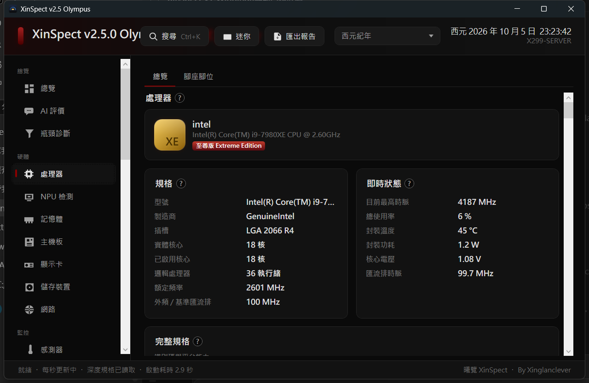
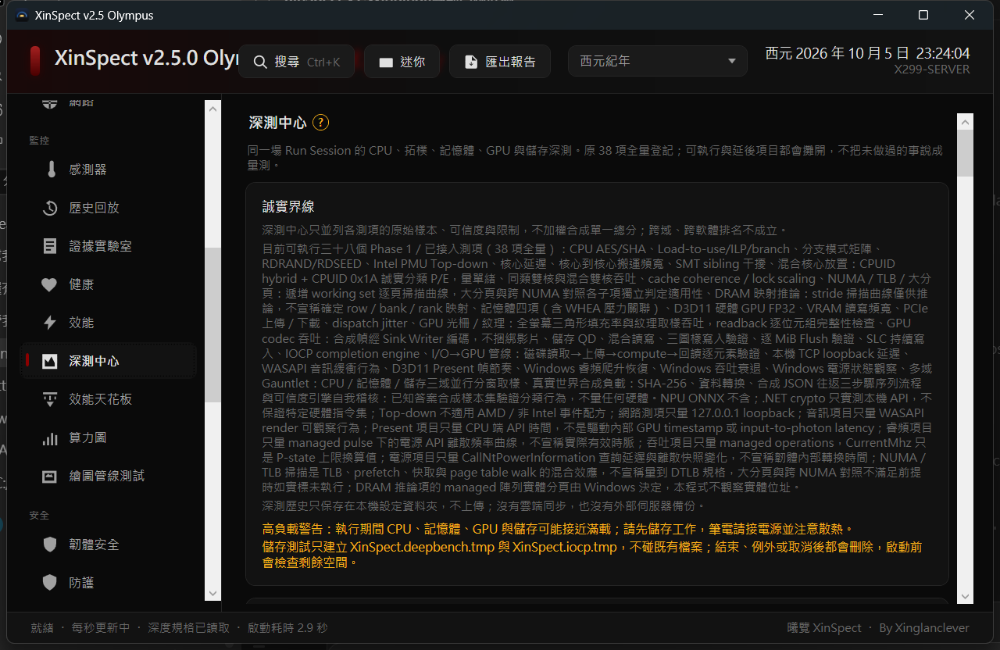
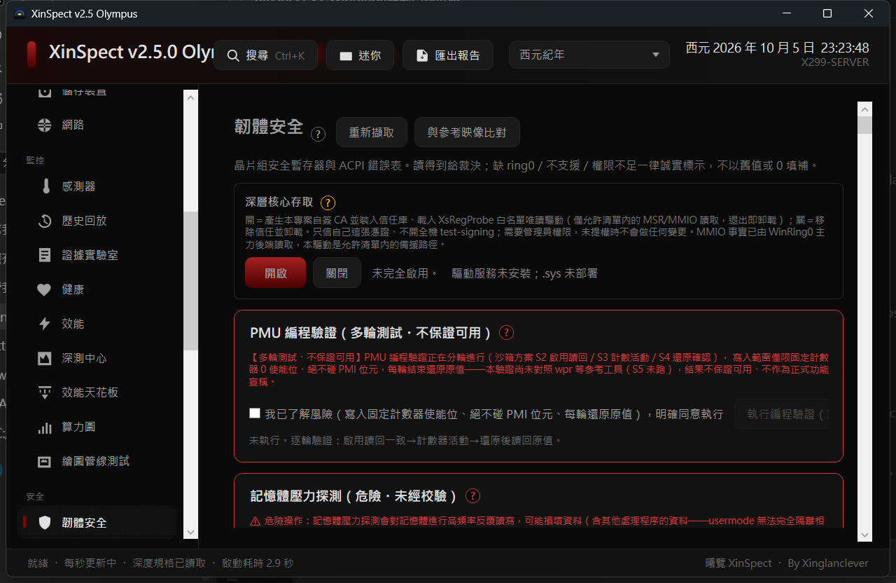
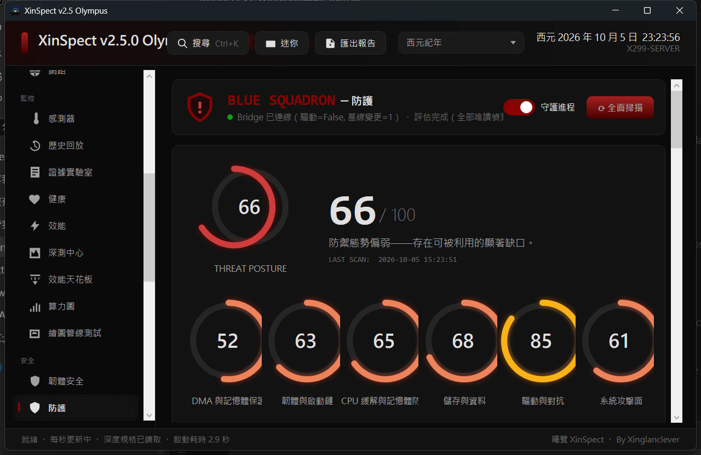

[繁體中文](README.md) · [简体中文](README.zh-CN.md) · English

[](https://xinspect.de5.net)

> The official site only presents documentation (overview, fact catalogue, features and data sources, version history, downloads). It **does not scan your machine** and needs no installation.

# XinSpect

**One machine, three accounts side by side: what the hardware says, what the firmware says, what the operating system says.**

Where it can read, it gives the value and its source (which register, which WMI class, which API). Where it cannot, it gives the reason. Where the three disagree, it names both sides in red and leaves the judgement to you.

*Altius, accuratius, stabilius—veracius.*


-512BD4)


> The 82% Stryker score covers only the pure-function `XinSpect.Decoders` library, not the GUI, CLI, or privileged access layer.


A **free, open-source Windows x64** toolbox: machine inspection, monitoring, overclocking, firmware-security auditing, deep measurement and evidence export.

Ships as a single portable executable. Low-level reads are **read-only by default**; advanced diagnostics and CPU/DRAM stress tests are **off by default**; hardware writes require a second safety switch plus per-action confirmation. It **collects and transmits no user data**.

> **Document scope (v3.27).** This English edition mirrors the structure of the Traditional Chinese reference README. The long-form narrative (page-by-page anatomy, per-key provenance, threshold tables) lives in the Chinese encyclopedia, [docs/百科-v3.17.md](docs/百科-v3.17.md); where the two disagree, the Chinese text is correct.

## Contents

- [What this is](#what-this-is)
- [Screenshots](#screenshots)
- [Features](#features)
- [Three accounts and six states](#three-accounts-and-six-states)
- [Download](#download)
- [Quick start](#quick-start)
- [The xsc terminal](#the-xsc-terminal)
- [Safety and data sovereignty](#safety-and-data-sovereignty)
- [Recomputable facts](#recomputable-facts)
- [Honest limits](#honest-limits)
- [Building from source](#building-from-source)
- [Documentation](#documentation)
- [License](#license)

## What this is

The premise is simple: **every property of a machine should be stated three ways** — what the hardware says (registers, SPD, SMART), what the firmware says (SMBIOS, ACPI, SPI write-protect state), and what the operating system says (WMI, PnP, ETW). When the three agree you have a number worth trusting; when they disagree, the tool's job is to **point at the contradiction** rather than quietly pick the flattering one.

- **Good for**: checking whether the memory you bought really is the die and timings it claims; inspecting firmware write protection and Secure Boot state; watching sensors and power curves; running stress tests whose results you can audit afterwards; exporting a machine's facts as evidence.
- **Not for**: benchmark leaderboards, "one-click maximum overclock" buttons, or a verdict on whether a machine is worth buying. This tool gives no purchasing advice and does not rank machines against each other.

## Screenshots

| Processor | Deep Bench |
|---|---|
|  |  |
| Specifications next to live state, every reading with its source | All 38 runnable items registered, including the ones that are not run |

| Firmware security | Protection |
|---|---|
|  |  |
| A verdict when it can read, an honest reason when it cannot | BlueSquadron threat posture, scored item by item |

> The screenshots above were captured on **v2.5.0**; page count, layout and information density have changed by v3.27. Trust the program, not the pictures.

## Features

65 reachable pages, in six groups by purpose:

| Group | Contents |
|---|---|
| **Inspection and reconciliation** | Overview, processor (with socket pinout), NPU detection, memory (SPD direct read / SMBIOS-WMI / CPU-Z, three sources side by side), motherboard, graphics, storage (SMART/NVMe), networking, sensors, hardware catalogue, fact atlas |
| **Monitoring and measurement** | Live sensors, history replay, sensor dashboard, frame time (ETW), DPC latency, network speed, power (RAPL energy-counter verification), health |
| **Performance and stress** | Performance ceiling, compute chart, graphics pipeline test, GPU render test, Deep Bench (44-item run session), CPU/DRAM/GPU stress, disk scan, hardware tests (keyboard/mouse/display), bottleneck diagnosis |
| **Firmware and security** | Firmware security (chipset security registers, ACPI error tables, SPI BIOS write protection), driver analysis, OS analysis, BlueSquadron protection (posture and scan) |
| **System tools** | Terminal (control console), DNS, Hosts, context menu, boot repair, startup items, junk cleanup, memory cleanup, sleep/display-link/NVMe power, ports, BSOD analysis, migration, overclock (CPU/GPU) and fans |
| **Evidence and governance** | Evidence Lab, compliance reports, Merkle evidence, audit-log hash chain, enterprise offline baselines, provenance and licence pages |

Plus **AI review** (bring your own API key) and a **built-in browser** (http／https only; boundaries below).

## Three accounts and six states

Every page marks **where its data comes from**. When a field has more than one source, they are listed together, and a mismatch is flagged in red as "hardware says X / OS says Y".

When something cannot be read, the tool does not print 0 and does not invent a plausible-looking value — it prints the **reason**: missing privilege, unsupported hardware, driver not loaded, firmware not implemented, timeout, blocked by a safety setting. That is what the six states are for: **"unreadable" and "zero" must never look the same**, or a complete-looking report is simply a dishonest one.

Running unelevated is not a fault: those pages show "—" plus the reason. That is exactly why the six-state degradation exists.

## Download

| File | Size | Notes |
|---|---|---|
| [XinSpect.exe](https://github.com/Xinglanclever/XinSpect/releases/download/v3.27/XinSpect.exe) | 39.3 MB | Main program. The BlueSquadron guardian is built in; the "control console" button bridges to the xsc terminal |
| [XinSpectConsole.exe](https://github.com/Xinglanclever/XinSpect/releases/download/v3.27/XinSpectConsole.exe) | 101.3 MB | The xsc terminal (CLI). Runs standalone and is also invoked from the main program; carries the .NET 10 runtime, hence the size |
| [BlueSquadronBridge.exe](https://github.com/Xinglanclever/XinSpect/releases/download/v3.27/BlueSquadronBridge.exe) | 6.5 MB | Standalone guardian, for running protection without the main program |
| [XinSpect-full.exe](https://github.com/Xinglanclever/XinSpect/releases/download/v3.27/XinSpect-full.exe) | 212.0 MB | Main program, runtime included: bundles the .NET 10 Desktop Runtime (same features as XinSpect.exe) |
| [XinSpectConsole-nort.exe](https://github.com/Xinglanclever/XinSpect/releases/download/v3.27/XinSpectConsole-nort.exe) | 67.3 MB | xsc terminal for Windows 11 / Server 2025, no runtime: requires .NET 10 Desktop Runtime |
| [XinSpectConsole-legacy-nort.exe](https://github.com/Xinglanclever/XinSpect/releases/download/v3.27/XinSpectConsole-legacy-nort.exe) | 67.3 MB | xsc terminal for Windows 10 / 2016 / 2019 / 2022, plain text, no runtime: requires .NET 10 Desktop Runtime |
| [XinSpectDeploy.exe](https://github.com/Xinglanclever/XinSpect/releases/download/v3.27/XinSpectDeploy.exe) | 29.7 KB | One-step installer. First pick A (main program) or B (xsc terminal); then pick a download source (GitHub / Drive / acceleration node). Shows progress, speed and time remaining |
| [XsRegProbe.sys](https://github.com/Xinglanclever/XinSpect/releases/download/v3.27/XsRegProbe.sys) | 24.1 KB | XsRegProbe kernel probe driver (whitelisted read-only MSR/MMIO; internal review is not third-party certification). Not Microsoft-signed: the main program installs it into `ProgramData\XinSpect\Driver\` and registers a service; manual loading needs testsigning |
| [XinSpectConsole-legacy.exe](https://github.com/Xinglanclever/XinSpect/releases/download/v3.27/XinSpectConsole-legacy.exe) | 101.3 MB | xsc terminal, **plain-text compatible build** for classic consoles on Windows 10 / Server 2016, 2019, 2022: no colour, no box drawing; facts/book/help behave the same |

> Sizes above are the published bytes of **v3.27**; trust the Release page. Per-asset SHA-256 is in `SHA256SUMS.txt` on the Release page (it guards against transfer corruption — an attacker who can replace the whole Release is out of scope; non-repudiation needs signing, which is scheduled).

**Requirements**: Windows 10 1903+ / Windows 11, x64. Builds without a runtime need the .NET 10 Desktop Runtime installed; `XinSpect-full.exe` and `XinSpectConsole.exe` already carry it.

## Quick start

1. **Download** `XinSpect.exe` (or run `XinSpectDeploy.exe`). To see what it does first, open the [official site](https://xinspect.de5.net).
2. **Just run it.** It starts with normal privileges (asInvoker, least privilege): inspection, reconciliation and report export all work.
3. **For the full feature set** (sensors, direct MSR reads, overclocking, deep firmware items), run it as administrator — running unelevated only means those pages show "—" and the reason, not that anything is broken.
4. Advanced diagnostics and stress tests are unlocked on the **Safety** page; hardware writes are a second-level switch and every write needs its own confirmation.

Uninstall: the main program is a single executable — delete it. If the XsRegProbe service was installed, clean it up from the Safety page or with `xsc --repair-ring0`.

## The xsc terminal

`XinSpectConsole.exe` (`xsc`) is the terminal and scripting entry point: **49 commands**, sharing the same read-only services as the GUI — no new writes, no daemon, no network.

```text
xsc                          # REPL (history, Tab completion, Ctrl+C to stop)
xsc help                     # command list
xsc facts                    # collect machine-wide facts
xsc page cpu                 # one page of facts
xsc domain storage           # query a fact domain
xsc fact cpu.model           # a single fact
xsc msr 0x19C                # direct MSR read (needs elevation)
xsc pci scan                 # PCI scan
xsc health                   # health summary
xsc compliance               # export compliance evidence
xsc merkle                   # Merkle evidence
xsc book                     # offline encyclopedia (embedded)
xsc --lang zh-TW             # interface language
```

- `xsc top` is a live view; **Ctrl+C stops it**. It refuses to start when piped, so scripts cannot hang on it.
- `xsc --repair-ring0` is an **explicit** repair (removes a stale WinRing0 service) — system writes are never hidden under another flag. The read-only health check is a separate `DiagnoseRing0Service`.
- `xsc --verify-audit [log path]` recomputes the audit log's hash chain: exit 0 = intact, 2 = broken or corrupt, 1 = fatal.

## Safety and data sovereignty

- **Read-only by default.** Low-level reads (registers, SPD, SMART, ACPI) never write; advanced diagnostics and CPU/DRAM stress are off by default; hardware writes need a second switch plus per-action confirmation.
- **No telemetry at all.** No accounts, no cloud sync, nothing collected or uploaded; live data stays on this machine.
- **Every networked feature is individually opt-in** (five paths in total); everything else runs locally.
- **API keys are encrypted with Windows DPAPI** before they are written to settings.json. If decryption fails you get "no key, plus the reason", and the settings page shows how the key is actually stored on disk.
- **The built-in browser only opens http/https**: `file://`, `javascript:`, `data:`, `about:` and friends are blocked, and the status bar says what was blocked.
- **Browser downloads land in `%USERPROFILE%\XinSpect\Downloads`**, not in the system Downloads folder.
- **Transient failures are retried** (429/502/503/504/408, honouring the endpoint's `Retry-After`, bounded attempts) and only before any output has been produced.
- **Developer tools are off by default**, enabled only when `XINSPECT_BROWSER_DEVTOOLS=1` is set explicitly.
- **Elevation is optional**: the main program starts with least privilege and only the pages that need kernel access ask for administrator.

## Recomputable facts

Every number here can be counted on a clean checkout. **How you count is part of the claim**: a different counting method yielding a different number is normal, but the method has to be written down.

| Item | Count | How to count (from the repo root) |
|---|---:|---|
| Catalogue keys / domains | 1,178 / 157 | Members of `Keys` in `Services/FactKeyCatalog.cs`; deduplicated first segment |
| Dynamic key families | 69 | Members of `Families` in `Services/FactKeyDynamicCatalog.cs` |
| Reachable pages | 65 | `Key =` entries in `Nav/PageRegistry.cs` |
| Help entries | 288 | Members of `Entries` in `Nav/HelpCatalog.cs` |
| Service files | 682 | `find Services -name '*.cs' \| wc -l` |
| Test cases (baseline) | 8,050 | `ProjectTests` in `Tests/TestSuiteBaseline.cs` |
| CLI commands | 49 | `grep -c 'case "' XinSpectCli/Program.cs` |
| Changelog entries | 132 | Members of `Entries` in `Nav/ChangelogCatalog.cs` |

Of 1,178 catalogue keys, most are reachable on mainstream platforms; special chipsets, OEM BIOSes, virtual machines and older platforms fall back to the six states. The fact catalogue (1,178 keys) spans hardware, operating system, security, diagnostics, provenance and governance — it is a catalogue, not a count of hardware readings. All 1,178 keys are listed with provenance in the Chinese encyclopedia.

**What this table does not prove.** A catalogue key is not a hardware reading; the review catalogue (116 items in v3.17, 111 in v3.18) is not a count of confirmed defects and not a third-party audit.

## Honest limits

1. **Kernel access**: production paths are third-party **WinRing0** and the in-house **XsRegProbe** (whitelisted read-only MSR/MMIO). **PawnIO is not wired in**; the **BlueSquadron** kernel driver builds locally but is not packaged, signed or runtime-validated, and is **not a production kernel path**.
2. **No Microsoft signature** (EV certificate plus WHQL is money and process). Until then, "download straight from the GitHub Release" is a necessary discipline; `SHA256SUMS.txt` guards transfer corruption only.
3. **The review is not third-party certification.** The 116 items in v3.17 and 111 in v3.18 come from author- and AI-assisted internal review, including the reviewer's own false positives — see [docs/審查報告-v3.17.md](docs/審查報告-v3.17.md).
4. **Long-tail hardware**: unusual chipsets, OEM BIOSes, virtual machines and older platforms fall back to "unreadable plus reason".
5. **Judgement stays with you**: no benchmark rankings, no recommended configurations, no buying advice, no cross-machine comparisons.
6. **Documentation tax**: code, key catalogue, help entries, encyclopedia and README are five representations guarded by tests — and guards fail too.
7. **Bus factor**: one maintainer plus AI agents; the HANDOFF practice is a hedge, not a cure.

## Building from source

Requires the .NET 10 SDK (the project targets `net10.0-windows`, WPF plus WinForms for the tray icon) and Python 3 for the documentation tools.

```bash
git clone https://github.com/Xinglanclever/XinSpect.git
cd XinSpect

dotnet build XinSpect.csproj -c Release
dotnet build XinSpectCli/XinSpectCli.csproj -c Release
dotnet test Tests/XinSpect.Tests.csproj          # 8,050-case baseline

python Tools/gen-docs-html.py                    # regenerate 百科.html / 手冊.html
python Tools/gen-readme-domains.py --check       # guard: README domain expansion vs catalogue
```

Read [CONTRIBUTING.md](CONTRIBUTING.md) before opening a pull request, and report security issues per [SECURITY.md](SECURITY.md).

## Documentation

| Document | Contents |
|---|---|
| [Official site](https://xinspect.de5.net) | Overview, fact catalogue, features and sources, version history, downloads (bilingual) |
| [百科.html](百科.html) · [手冊.html](手冊.html) | Self-contained HTML with contents and anchors, readable offline (this is the in-app encyclopedia) |
| [docs/百科-v3.17.md](docs/百科-v3.17.md) | The narrative body: page-by-page anatomy, per-key provenance, threshold tables |
| [docs/FEATURE-REFERENCE.md](docs/FEATURE-REFERENCE.md) | Feature-to-source reference |
| [WHITEPAPER.en.md](WHITEPAPER.en.md) | Design whitepaper |
| [THIRD-PARTY-NOTICES.md](THIRD-PARTY-NOTICES.md) | Third-party components, licences and sources |

## Contributing and feedback

- Read [CONTRIBUTING.md](CONTRIBUTING.md) first; the code of conduct is [CODE_OF_CONDUCT.md](CODE_OF_CONDUCT.md).
- Report security issues privately per [SECURITY.md](SECURITY.md) rather than in a public issue.
- Usage questions and known limitations are covered in [SUPPORT.md](SUPPORT.md).

## License

Dual-licensed; pick either path, the features are identical:

- **AGPL-3.0-or-later**: free, commercial use allowed, but distributing modified versions or offering it as a network service requires releasing the source under the same licence.
- **Commercial licence** (see [COMMERCIAL-LICENSE.md](COMMERCIAL-LICENSE.md)): paid, for closed-source integration, shipping with hardware, or organisations whose policy forbids copyleft. No source-release obligation.

Third-party components (Intel XTU SDK, LibreHardwareMonitor, TraceEvent, NAudio, WebView2 and others) keep their own licences.

## Version history

The table below lists every release from 2.60 onward with its one-line summary. The complete itemised ledger (132 entries) lives in [docs/百科-v3.17.md](docs/百科-v3.17.md) (part 11); per-release notes are on the [Releases page](https://github.com/Xinglanclever/XinSpect/releases).

| Version | Date | Summary |
|---|---|---|
| 3.27 | 2026-11-12 | Memory WMI fallback and SPD timeout |
| 3.26 | 2026-11-12 | Fix DIMM SPD discovery, DDR5 address coverage and source/timing diagnostics |
| 3.25 | 2026-11-11 | Desktop/CLI safety and targeted Deep Bench parity, OpenCC conversion, strict Big5 decoding and safe EC presence detection |
| 3.24 | 2026-11-10 | Reduce monitoring overhead and correct network sampling baselines |
| 3.23 | 2026-11-10 | Hardware decoding and evidence accuracy fixes |
| 3.22 | 2026-11-10 | Enterprise offline baselines and hardware source contracts |
| 3.21 | 2026-11-09 | Audit round 2: sweep patches 29-43 applied, audit list closed out, dossier merge |
| 3.20 | 2026-11-08 | Build-repair & full audit: all three projects compile again, P0-4 applied, 30+ fixes across CLI/desktop/services |
| 3.18 | 2026-11-07 | Audit remediation: 116 findings fixed + honest power gate + on-demand elevation |
| 3.17 | 2026-11-05 | 終端機定稿：Claude Code 式界面、永不崩 REPL、百科嵌入 |
| 3.16 | 2026-11-04 | Power Console CLI, rf.* out-of-band facts, theme persistence fix |
| 3.15 | 2026-11-03 | Theme memory fix, offline Redfish catalog, mini HUD re-wake |
| 3.14 | 2026-11-03 | Enterprise evidence exits: compliance, Merkle, speculation, CI/SIEM exports and fleet baseline |
| 3.13 | 2026-11-01 | Surveillance planning calculators and a refreshed Blue Squadron baseline |
| 3.12 | 2026-11-01 | Swiss theme becomes the 3.12 baseline; optional CPU/GPU catalog; four release assets |
| 3.11 | 2026-10-31 | Swiss Modernist interface with Helvetica (beta) |
| 3.10 | 2026-10-31 | The overview now leads with what this machine is — capsule summary plus a details list; gauges off by default |
| 3.09 | 2026-10-31 | App icon replaced with the brand artwork (blue X over two window cards) |
| 3.08 | 2026-10-31 | The app now states dual licensing too, and says it applies to all versions |
| 3.07 | 2026-10-31 | The disclaimer now matches the licence (no more no-commercial-use claim), and the About page gains a commercial-licence route and a brand line |
| 3.06 | 2026-10-31 | The deployer finally draws a real download progress line; the part chip on upgrade suggestions is now dark grey |
| 3.05 | 2026-10-30 | Official site goes live: a primary button on the About page, the first card on the start page, a banner atop all three READMEs |
| 3.04 | 2026-10-30 | Making unreadable, imprecise and undated into facts: 22 rounds closing the third circle, plus a batch of already-shipping defects (rounds 309-330) |
| 3.03 | 2026-10-27 | Everything visible got fixed: home page and forum navigation, the sensor dashboard revived, two-layer M.2/U.2 reporting, and a mini overlay with 15 items and two styles (rounds 301-308) |
| 3.02 | 2026-10-26 | Visible completion and invisible wiring: AI usage and transcript export, in-page find, and 95 views actually constructed (rounds 292–299) |
| 3.01 | 2026-10-26 | Guards where they are actually walked: changelog reconciliation, AI redaction and split timeouts, a browser that only opens http(s) (rounds 289–291) |
| 3.00 | 2026-10-26 | Who watches the present tense: README numbers recomputed by machine, a built-in knowledge inventory, provenance tiers for PCI names, and four shape guards on facts (rounds 278–288) |
| 2.99 | 2026-10-27 | EDID CTA-861 extension block plus the VIC knowledge pack, and two defects that were quietly lying (rounds 275–277) |
| 2.91 | 2026-10-26 | Closing two registered-but-unfed keys: SMART lookup statistics now read real ATA attributes, and the audit-chain cross-check finally has a producer (round 274) |
| 2.90 | 2026-10-25 | Round two: self-load checks join the deep-bench suite, four visualization controls and a sensor dashboard page, export and report extensions (rounds 272–273) |
| 2.89 | 2026-10-25 | The 10,000-item catalogue lands and round one closes: quadruple dedup, 30 new items in three batches, SMART vendor knowledge pack, and two honest corrections to the verdicts themselves (rounds 268–271) |
| 2.88 | 2026-10-25 | Documentation is an interface too: trilingual hardcore guides, the fact-and-data dictionary, and a vtable slot no behavioural test could see (round 267) |
| 2.87 | 2026-10-19 | Proving rather than asserting: six firmware-risk facts, peripheral updatability declarations, and two silently wrong bus tables (rounds 264–266) |
| 2.86 | 2026-10-18 | Visible completion and invisible defects: Fact Atlas, three UEFI-variable gaps, an outer budget for the NVMe probe (rounds 259–263) |
| 2.85 | 2026-10-16 | ULTIMATE-1000 phase one: contracts, skeletons, provenance chain and guard methodology (105 items) |
| 2.84 | 2026-10-15 | Five-domain deepening: storage, security, ACPI, visualisation, scenarios (items 484–523) |
| 2.83 | 2026-10-14 | Engineering governance II (items 470–483) plus the NVMe log-page hang fix |
| 2.82 | 2026-10-14 | Offline analysis, product platform and Deep Bench methodology (items 371–399) |
| 2.81 | 2026-10-14 | Bus deepening, engineering governance and visualisation (items 346–370) |
| 2.80 | 2026-10-14 | Performance observation, Deep Bench wave two and governance close-out (items 323–345) |
| 2.79 | 2026-10-14 | Platform, storage and scenario close-out (items 303–322) |
| 2.78 | 2026-10-13 | Platform expansion (items 293–302) |
| 2.77 | 2026-10-13 | Firmware and boot auditing (items 253–272) |
| 2.76 | 2026-10-13 | Recovery deepening and security-audit supplement (items 223–252) |
| 2.75 | 2026-10-13 | Network security and final inventory (items 203–222) |
| 2.74 | 2026-10-13 | Inventory, governance and system register (items 173–202) |
| 2.73 | 2026-10-13 | Advanced supplement: caches, virtualisation, runtimes, topology, governance (items 163–172) |
| 2.72 | 2026-10-13 | Lifecycle, external interfaces and automation (items 113–142) |
| 2.71 | 2026-10-12 | Scenarios, multimedia and maintenance (items 94–112) |
| 2.70 | 2026-10-12 | Zero trust and data security (items 67–83) |
| 2.69 | 2026-10-12 | Licence changed to AGPL-3.0-or-later |
| 2.68 | 2026-10-12 | Vol2 items 31–55: maintenance, runtime, close-out, plus WPBT |
| 2.67 | 2026-10-12 | Vol2 items 21–30: PCIe capability chain, PPTT, server roles |
| 2.66 | 2026-10-11 | P0-09 offline knowledge-pack update (zero-network preserved) |
| 2.65 | 2026-10-11 | P0-02 FIT table (boot trust-root directory) and Boot Guard boundary |
| 2.64 | 2026-10-11 | P0-10 third-party notices; P0-07 error aggregation on the CLI |
| 2.63 | 2026-10-11 | P0-03 listening-port three-way comparison: socket × process × signature |
| 2.62 | 2026-10-11 | P0-01 TPM event-log replay comparison (third-party verification) |
| 2.61 | 2026-10-11 | P0-04 blue-screen archaeology: minidump reading and bugcheck decoding |
| 2.60 | 2026-10-11 | Two carry-overs from v2.56: event annotations on the timeline, explicit disk deep-scan entry |

## Sponsorship

If you would like to support individual maintenance, you can buy the author a coffee; please keep each contribution at **1.5 USD** or more. This is a voluntary channel with no support or reply commitment attached. Check the network before sending — on-chain transfers are usually irreversible.

| Asset | Network | Address |
|---|---|---|
| USDT | Tron (TRC20) | `TQPk1DfaHBCKNt8W5UUJDH3XkwAArmmNqH` |
| USDT | Solana | `34o5GGmamdV8k9vYYaaRABZpSNXpphbSXdhBsASN8XN4` |
| USDT | BNB Smart Chain (BEP20) | `0x8811d8EF822cC9cf546fe24C565b861291e1B704` |
| USDC | Ethereum (ERC20) | `0x8811d8EF822cC9cf546fe24C565b861291e1B704` |
| USDC | Solana | `34o5GGmamdV8k9vYYaaRABZpSNXpphbSXdhBsASN8XN4` |
| ETH | Ethereum | `0x8811d8EF822cC9cf546fe24C565b861291e1B704` |
| BTC | Bitcoin | `1PsY7aUbmHEVdM4g5EVQLncMFDEFnak3qF` |

---

**About this document**: it corresponds to XinSpect v3.27 (2026-11-12). The three READMEs differ only in language; their numbers and safety boundaries are pinned to one source by guard tests.
