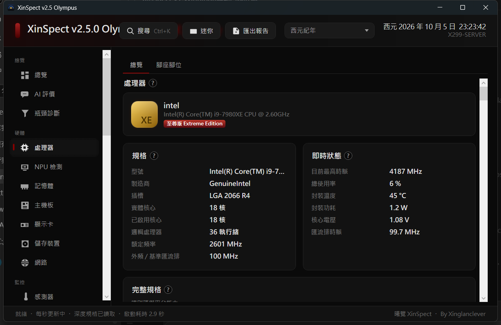
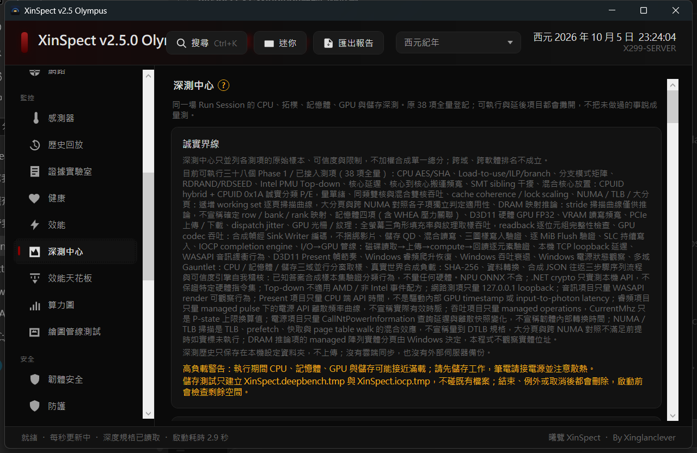
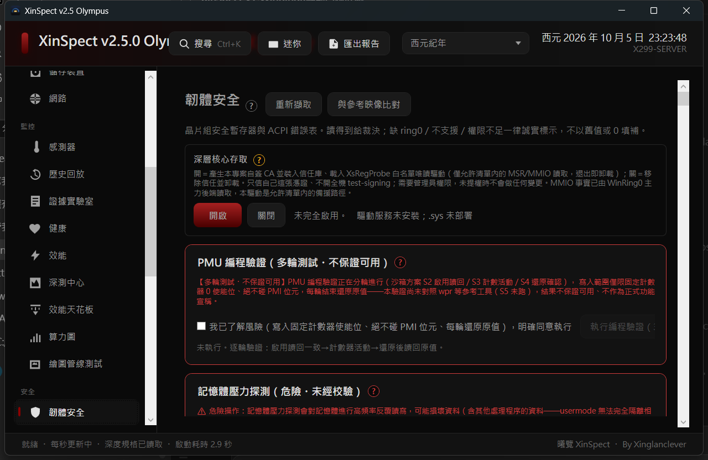
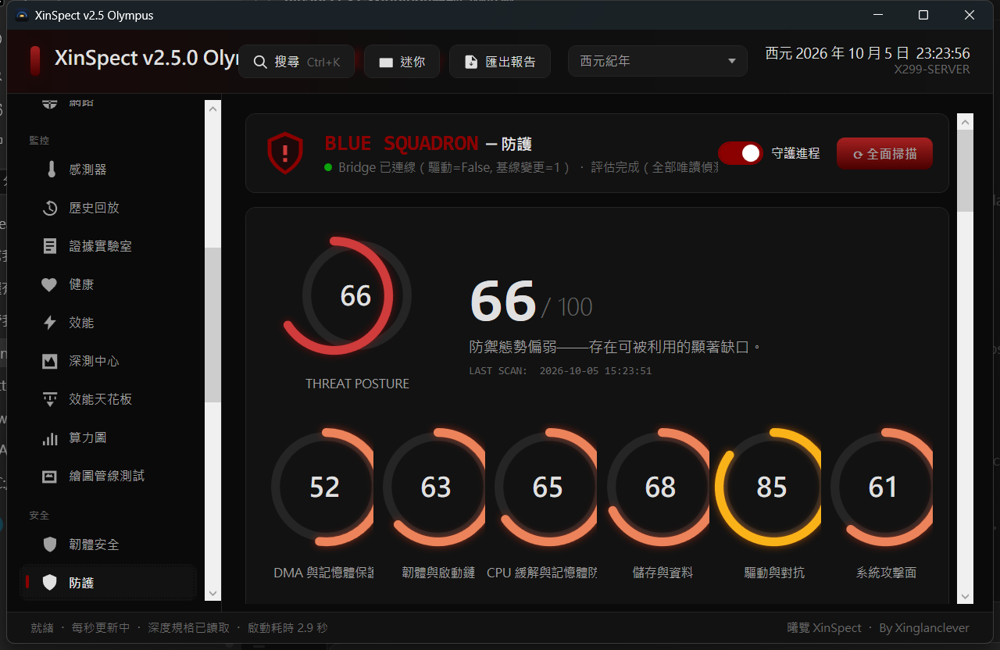

[简体中文](README.zh-CN.md) · 繁體中文 · [English](README.en.md)

[](https://xinspect.de5.net)

> 官方網站只呈現說明（產品總覽、事實目錄、版本沿革、下載），**不會掃描你的電腦**，也不需要安裝。

# 曦覽 XinSpect

**同一台機器，三份陳述並排：硬體說的、韌體說的、作業系統說的。**

**更深、更準、更穩——更誠實。**

能讀的給數值與出處（哪個暫存器、哪個 WMI 類別、哪個 API），讀不到的給原因，互相矛盾的紅字具名列出雙方——判讀留給你。

*Altius, accuratius, stabilius—veracius.*


-512BD4)


> Stryker 82% 僅涵蓋 `XinSpect.Decoders` 純解碼器類別庫，不代表整個 GUI、CLI 或核心存取層。


一款**免費開源、Windows x64** 的電腦工具箱：驗機、監控、超頻、韌體安全稽核、深度量測與證據導出。

單一執行檔、免安裝。底層讀取**預設唯讀**；進階診斷與 CPU／DRAM 壓力測試**預設關閉**；硬體寫入另有第二級開關並需逐項確認。**不收集、不上傳任何使用者資料。**

> 它不替你下結論。市面上的工具多半給你一個分數或一句「體質良好」；曦覽給的是三份原始陳述與它們的出處，矛盾的地方具名列出，判讀留給人。

## 目錄

- [這是什麼](#這是什麼)
- [畫面](#畫面)
- [主要功能](#主要功能)
- [三源對帳與六態](#三源對帳與六態)
- [下載](#下載)
- [快速開始](#快速開始)
- [xsc 終端機](#xsc-終端機)
- [安全邊界與資料主權](#安全邊界與資料主權)
- [誠實邊界](#誠實邊界)
- [從原始碼建置](#從原始碼建置)
- [文件導覽](#文件導覽)
- [授權](#授權)

## 這是什麼

曦覽的立場很簡單：**一台電腦的每一項性質，都應該分成三份陳述來看**——硬體自己說的（暫存器、SPD、SMART）、韌體說的（SMBIOS、ACPI、SPI 防寫狀態）、作業系統說的（WMI、PnP、ETW）。三者一致時你得到一個可信的數字；三者不一致時，工具的工作是**把矛盾指出來**，而不是挑一個順眼的蓋掉。

- **適合**：想確認買到的記憶體是不是標示的顆粒與時序、想查韌體防寫與 Secure Boot 狀態、想看感測器與功耗曲線、想跑有紀錄可回查的壓力測試、想把一台機器的事實導出成證據。
- **不適合**：想要「跑分排名」、想要「一鍵超頻到最高」、想要一句「這台值不值得買」。本工具不給採購建議，也不跨機型排名。

## 畫面

| 處理器 | 深測中心 |
|---|---|
|  |  |
| 規格與即時狀態並列，讀值附出處 | 38 項可執行項全量登記，不做的項目也列出來 |

| 韌體安全 | 防護 |
|---|---|
|  |  |
| 讀到就給裁決，缺權限就誠實標示原因 | BlueSquadron 威脅態勢與逐項評分 |

> 上列畫面擷取自 **v2.5.0**；v3.28 的頁面數量、版面與資訊密度均已變動，實際以程式為準。

## 主要功能

65 個可到達頁面，依用途分六組：

| 分組 | 內容 |
|---|---|
| **驗機與對帳** | 總覽、處理器（含腳座位位腳圖）、NPU 檢測、記憶體（SPD 直讀／SMBIOS-WMI／CPU-Z 三來源並列）、主機板、顯示卡、儲存裝置（SMART／NVMe）、網路、感測器、硬體目錄、事實地圖 |
| **監控與量測** | 即時感測器、歷史回放、感測器儀表板、幀時間（ETW）、DPC 延遲、網路速度、功耗（RAPL 能量計驗證）、健康 |
| **效能與壓力** | 效能天花板、算力圖、繪圖管線測試、GPU 算繪測試、深測中心（44 項 Run Session）、CPU／DRAM／GPU 壓力測試、磁碟掃描、硬體測試（鍵盤／滑鼠／螢幕）、瓶頸診斷 |
| **韌體與安全** | 韌體安全（晶片組安全暫存器、ACPI 錯誤表、SPI BIOS 防寫）、驅動分析、系統分析、BlueSquadron 防護（威脅態勢與掃描） |
| **系統工具** | 終端機（強控台）、DNS、Hosts、右鍵選單、開機修復、啟動項、垃圾清理、記憶體清理、休眠／顯示連結／NVMe 電源、連接埠、藍屏分析、系統遷移、超頻（CPU／GPU）與風扇 |
| **證據與治理** | 證據實驗室、合規報告、Merkle 證據、審計日誌雜湊鏈、企業離線基準、來源與授權頁 |

另有 **AI 評價**（自備 API 金鑰）與**內建瀏覽器**（只開 http／https，界線見下節）。

## 三源對帳與六態

每一頁的資料都標出**它從哪裡來**。同一個欄位有兩條以上來源時，曦覽會並排列出，不一致就紅字標示「硬體說 X／作業系統說 Y」。

讀不到的時候，它不是填 0、也不是填一條看起來很正常的假值，而是給出**原因**：缺權限、硬體不支援、驅動未載入、韌體未實作、逾時、被安全設定擋下。這就是所謂的六態：**「讀不到」與「值是零」在畫面上必須長得不一樣**，否則一份看起來完整的報告就是一份騙人的報告。

未提權不是壞掉——那些頁面會整片顯示「—」與原因，這正是六態降級設計存在的理由。

## 下載

| 檔案 | 大小 | 說明 |
|---|---|---|
| [XinSpect.exe](https://github.com/Xinglanclever/XinSpect/releases/download/v3.28/XinSpect.exe) | 39,304,345 bytes | 主程式。藍色中隊守護進程已內建；「強控台」按鈕橋接 xsc 終端機 |
| [XinSpectConsole.exe](https://github.com/Xinglanclever/XinSpect/releases/download/v3.28/XinSpectConsole.exe) | 101,291,466 bytes | 曦覽終端機（CLI）。可獨立執行，也被主程式強控台喚起；自含 .NET 10 執行階段故體積較大（見下方說明） |
| [BlueSquadronBridge.exe](https://github.com/Xinglanclever/XinSpect/releases/download/v3.28/BlueSquadronBridge.exe) | 6,531,620 bytes | 獨立守護進程。要脫離主程式單獨跑防護時使用 |
| [XinSpect-full.exe](https://github.com/Xinglanclever/XinSpect/releases/download/v3.28/XinSpect-full.exe) | 212,070,592 bytes | 主程式・帶環境版：.NET 10 Desktop Runtime 一併打包，免裝執行階段（功能與 XinSpect.exe 相同） |
| [XinSpectConsole-nort.exe](https://github.com/Xinglanclever/XinSpect/releases/download/v3.28/XinSpectConsole-nort.exe) | 67,384,326 bytes | 曦覽終端機・Windows 11／Server 2025・不帶環境：需已裝 .NET 10 Desktop Runtime |
| [XinSpectConsole-legacy-nort.exe](https://github.com/Xinglanclever/XinSpect/releases/download/v3.28/XinSpectConsole-legacy-nort.exe) | 67,384,414 bytes | 曦覽終端機・Windows 10／2016/2019/2022・不帶環境：純文字界面，需已裝 .NET 10 Desktop Runtime |
| [XinSpectDeploy.exe](https://github.com/Xinglanclever/XinSpect/releases/download/v3.28/XinSpectDeploy.exe) | 29,696 bytes | 一鍵安裝器。第一層選裝什麼：A 裝主程式（GUI）、B 裝曦覽終端機；第二層 1/2/3 選下載來源（GitHub／Drive／加速節點）；下載時顯示進度條、速度與剩餘時間 |
| [XsRegProbe.sys](https://github.com/Xinglanclever/XinSpect/releases/download/v3.28/XsRegProbe.sys) | 24,064 bytes | XsRegProbe 內核探測驅動（白名單唯讀 MSR／MMIO；內部檢視不構成第三方認證）。未微軟簽章：主程式以提權會話安裝到 `ProgramData\XinSpect\Driver\` 並建服務；手動載入需測試簽章環境（testsigning） |
| [XinSpectConsole-legacy.exe](https://github.com/Xinglanclever/XinSpect/releases/download/v3.28/XinSpectConsole-legacy.exe) | 101,291,554 bytes | 曦覽終端機（CLI）**純文字相容版**：給 Windows 10／Windows Server 2016、2019、2022 的傳統主控台——無色彩、無框線定位，其餘功能（facts／book／help）相同 |

> **上表的位元組數為本版（v3.28）實際發佈的檔案大小**；請以 Release 頁面列出的檔案為準。逐資產 SHA-256 見 Release 頁的 `SHA256SUMS.txt`（防傳輸損毀；能替換整個 Release 的攻擊者防不了——不可否認性需簽名，列排期）。

**需求**：Windows 10 1903 以上／Windows 11、x64。不帶環境的版本需先安裝 .NET 10 Desktop Runtime；`XinSpect-full.exe` 與 `XinSpectConsole.exe` 已自帶執行階段。

**安裝器**（`XinSpectDeploy.exe`）第一層先選裝什麼：**A** 是主程式（全自動部署主程式＋守護進程；守護進程自 3.13 起預設不啟用，要自己到安全頁開）、**B** 是曦覽終端機（單檔下載一步到位）。下載完成後一律檢查 PE 標頭與大小門檻，抓到 HTML（分享頁、限流頁）會被擋下、刪檔並說出內容像什麼。注意：走第三方加速節點的位元組只能驗 PE 標頭，驗不了發佈者簽章。

## 快速開始

1. **下載** `XinSpect.exe`（或跑 `XinSpectDeploy.exe` 一鍵裝）。想先看它會做什麼，可開[官方網站](https://xinspect.de5.net)——網站只呈現說明，不掃描你的電腦。
2. **直接執行**。預設以一般權限啟動（asInvoker，最小特權）：驗機、對帳、匯出報告都能用。
3. **要看完整功能**（感測器、MSR 直讀、超頻、韌體安全深層項）時，才「以系統管理員身分執行」——不提權只是那些頁面顯示「—」與原因，不是壞掉。
4. 進階診斷與壓力測試在**安全頁**才打得開；硬體寫入是第二級開關，且每一次寫入都要逐項確認。

解除安裝：主程式是單一執行檔，刪掉即可；若曾安裝 XsRegProbe 服務，於安全頁或 `xsc --repair-ring0` 清理。

## xsc 終端機

`XinSpectConsole.exe`（`xsc`）是同一個產品對終端與腳本的入口：**49 個指令**，與 GUI 共用同一套唯讀服務——不新增寫入、不常駐、不連網。

```text
xsc                          # 進入 REPL（↑↓ 歷史、Tab 補全、Ctrl+C 停）
xsc help                     # 指令總表
xsc facts                    # 採集全機事實
xsc page cpu                 # 單頁事實
xsc domain storage           # 依事實域查詢
xsc fact cpu.model           # 單一事實
xsc msr 0x19C                # 直讀 MSR（需提權）
xsc pci scan                 # PCI 掃描
xsc health                   # 健康摘要
xsc compliance               # 合規證據導出
xsc merkle                   # Merkle 證據
xsc book                     # 離線百科（內嵌）
xsc --lang zh-CN             # 介面語言
```

- `xsc top` 是即時刷新檢視，**Ctrl+C 停止**；管線模式下會拒絕啟動，不讓腳本掛死。
- `xsc --repair-ring0` 是**明示**的修復動作（刪除死指針的 WinRing0 服務）——系統寫入不藏在別的旗標底下；唯讀健檢另有 `DiagnoseRing0Service`。
- `xsc --verify-audit [日誌路徑]` 逐筆重算審計日誌的雜湊鏈：退出碼 0＝鏈完整、2＝鏈斷或檔案損毀、1＝致命。

## 安全邊界與資料主權

- **預設唯讀**。底層讀取（暫存器、SPD、SMART、ACPI）預設只讀不寫；進階診斷與 CPU／DRAM 壓力測試預設關閉；硬體寫入需第二級開關＋逐項確認。
- **沒有任何遙測**。不收集、不上傳使用者資料，沒有帳號、沒有雲端同步；所有即時資料只留在這台機器。
- **需要連網的功能全部逐項 opt-in**，共五條路徑；其餘一律本機完成。
- **API 金鑰以 Windows DPAPI 加密後才寫進 settings.json**，解不開就是「沒有金鑰＋原因」，設定頁顯示磁碟上實際的存放方式。
- **內建瀏覽器只開 http／https**：`file://`、`javascript:`、`data:`、`about:` 等一律擋下，左下角說明被擋的是什麼。
- **瀏覽器下載落在 `%USERPROFILE%\XinSpect\Downloads`**，不落系統下載資料夾。
- **暫時性失敗重試**（429／502／503／504／408，依端點的 `Retry-After`、有限次），且只在還沒吐出任何字之前重試。
- **開發者工具預設關閉**，只在明確設定 `XINSPECT_BROWSER_DEVTOOLS=1` 後才開啟。
- **提權是可選的**：主程式以最小特權啟動，只有需要核心通路的頁面才要求管理員。

## 這棵樹的事實表（可複算）

下表每一個數字都能在乾淨 checkout 上當場數出來，數法寫在第三欄。**數法是內容的一部分**：換一種數法得到別的數字是正常的，但數法必須寫出來，否則讀者無從反駁，也無從複算。

| 類別 | 數量 | 數法（在倉庫根執行） |
|---|---:|---|
| 編譯期事實鍵 | **1,178** | `Services/FactKeyCatalog.cs` 的 `Keys` 成員數 |
| 事實域（鍵的第一段前綴） | **157** | 1,178 把鍵各自取第一段後去重 |
| 動態鍵家族 | **69** | `Services/FactKeyDynamicCatalog.cs` 的 `Families` 成員數 |
| 一鍵域／≤3 鍵域／≥20 鍵域 | 34／67／12 | 以域分組後計數 |
| 可到達畫面（`PageRegistry`） | **65** | `Nav/PageRegistry.cs` 的 `Key =` 條目數 |
| XAML 檔（含對話框與控制項） | **82** | `ls Views/*.xaml` |
| 全站說明條目（圓圈問號） | **288** | `Nav/HelpCatalog.cs` 的 `Entries` 成員數 |
| 服務檔 | **683** | `find Services -name '*.cs' \| wc -l` |
| 全域 C# 檔 | **1,615** | 走訪所有 `*.cs`，排除 `obj/`、`bin/`、`work/`、`publish-*/`、`.git/` |
| 版本紀錄筆數 | **133** | `Nav/ChangelogCatalog.cs` 的 `Entries` 成員數 |
| 專案測試基線 | **8,059** | `Tests/TestSuiteBaseline.cs` 的 `ProjectTests`（`dotnet test` 的總數） |
| CLI 指令（`Execute` case 標籤） | **49** | `grep -c 'case "' XinSpectCli/Program.cs` |
| 核心／特權後端列項 | **4** | WinRing0（第三方、已接入）／XsRegProbe（自研、已接入）／PawnIO（未接入）／BlueSquadron 核心驅動（未封裝） |
| AI 輔助內部審查編目 | **116** | `docs/審查報告-v3.17.md` 的編目條目；v3.18 另列 111 條。不是確認缺陷數，也不是第三方審計 |

**這張表不能證明什麼。** 1,178 是硬體、作業系統、安全、診斷、來源與治理等項目的整體目錄數，不是 1,178 項硬體讀值。審查編目也不是確認缺陷數；報告記錄了代理發現與作者驗證，不能替代獨立第三方審計。

---

## 誠實邊界

讀之前，先把不能做的事說清楚：

1. **核心通路面**：生產路徑是第三方 **WinRing0** 與自研 **XsRegProbe**（白名單唯讀 MSR／MMIO）。**PawnIO 未接入**（Native 綁定與 `ModulePins` 未完成）；**BlueSquadron** 的 C 核心驅動僅本機編譯通過，未封裝、未簽章、未執行驗證，**不列為生產核心路徑**。
2. **沒有微軟簽章**（EV 憑證＋WHQL 是錢與流程）。因此「從 GitHub Release 直連下載」是使用者的必要紀律；`SHA256SUMS.txt` 只能防傳輸損毀，不能防替換整個 Release 的攻擊者。
3. **審查不是第三方認證**。v3.17 的 116 條與 v3.18 的 111 條是作者與 AI 代理輔助的內部檢視，含審計者自己的誤報；完整清單與修復狀態見 [docs/審查報告-v3.17.md](docs/審查報告-v3.17.md)、[docs/審查報告-v3.18.md](docs/審查報告-v3.18.md)。
4. **硬體長尾**：1,178 把鍵在主流平台上覆蓋良好，特殊晶片組、OEM 客製 BIOS、虛擬機與老平台會落回六態的「讀不到＋原因」，那不是 bug 被藏起來，而是原因被寫出來。
5. **判讀留給人**：本工具不回答性能排名、推薦配置、購買建議，也不跨機型比大小。
6. **文檔稅**：代碼、鍵目錄、說明條目、百科、README 是五重表示；守門測試釘住一致性，而守門也會紅燈失守——長期解法是單一來源生成。
7. **bus factor**：專案由單人＋AI 代理維護，品質依賴守門人本人；HANDOFF 制度是對沖，不是解藥。

## 從原始碼建置

需要 .NET 10 SDK（本專案以 `net10.0-windows` 編譯，WPF＋WinForms 系統匣），文件工具另需 Python 3。

```bash
git clone https://github.com/Xinglanclever/XinSpect.git
cd XinSpect

dotnet build XinSpect.csproj -c Release          # 主程式
dotnet build XinSpectCli/XinSpectCli.csproj -c Release
dotnet test Tests/XinSpect.Tests.csproj          # 8,059 項基線

python Tools/gen-docs-html.py                    # README.md → 百科.html（改了 README 就要重跑）
python Tools/gen-readme-domains.py --check       # 守門：README 逐域展開與鍵目錄一致
```

送 PR 前請先讀 [CONTRIBUTING.md](CONTRIBUTING.md)；安全問題請依 [SECURITY.md](SECURITY.md) 回報，不要在 issue 裡貼未修補的細節。

## 文件導覽

| 文件 | 內容 |
|---|---|
| [官方網站](https://xinspect.de5.net) | 產品總覽、事實目錄、功能與資料源、版本沿革、下載（雙語，不掃描你的電腦） |
| [百科.html](百科.html) · [手冊.html](手冊.html) | 自足 HTML，含目錄與錨點，離線可讀（程式內「百科」即此檔） |
| [docs/百科-v3.17.md](docs/百科-v3.17.md) | 百科敘事主體（87 萬字）：逐頁解剖、逐鍵出處、門檻速查 |
| [docs/FEATURE-REFERENCE.md](docs/FEATURE-REFERENCE.md) | 功能與資料源對照 |
| [docs/AUDIT-CLAIMS-2026-11-12.md](docs/AUDIT-CLAIMS-2026-11-12.md) | 審計指控逐條核查 |
| [WHITEPAPER.md](WHITEPAPER.md) | 設計白皮書 |
| [THIRD-PARTY-NOTICES.md](THIRD-PARTY-NOTICES.md) | 第三方元件授權與來源 |
| [APPLICATION-LOG.md](APPLICATION-LOG.md) · [docs/ITERATIONS.md](docs/ITERATIONS.md) | 開發日誌與迭代紀錄 |

## 參與與回饋

- 送 PR／回報問題前先讀 [CONTRIBUTING.md](CONTRIBUTING.md)；本專案的行為準則見 [CODE_OF_CONDUCT.md](CODE_OF_CONDUCT.md)。
- 安全問題請依 [SECURITY.md](SECURITY.md) 私下回報，不要在 issue 裡貼未修補的細節。
- 使用問題與已知限制見 [SUPPORT.md](SUPPORT.md)。

## 授權

雙授權，兩條路二選一、功能相同：

- **AGPL-3.0-or-later**：免費、可商業使用，但散布修改版或以網路服務提供時須以相同授權開源。
- **商業授權**（見 [COMMERCIAL-LICENSE.md](COMMERCIAL-LICENSE.md)）：付費，供閉源整合、隨硬體出貨或組織政策禁用 copyleft 的情況，不觸發原始碼公開義務。

第三人元件（Intel XTU SDK／LibreHardwareMonitor／TraceEvent／NAudio／WebView2 等）維持各自授權，`THIRD-PARTY-NOTICES.md` 逐欄記載其授權與來源。

## 版本沿革（近期）

- **v3.28 內建工具箱擴充與 Agent 唯讀橋接**（2026-11-14）：保留內建工具，新增自訂 EXE／網址及 protocol v1 唯讀橋接。
- **v3.27 記憶體 WMI 即時回退與 SPD 逾時修正**（2026-11-12）：記憶體 WMI 即時回退與 SPD 超時修正。
- **v3.26 DIMM SPD 偵測與診斷修正**（2026-11-12）：iMC 改用 Windows PnP 定位；補上 DDR5 0x51–0x57 hub 偵測及直讀／SMBIOS-WMI／CPU-Z 來源與耗時診斷。
- **v3.25 雙級安全模式與平台靶向深測**（2026-11-11）：兩級開關預設關閉；桌面與 CLI 共用安全設定及平台靶向 Deep Bench。新增 OpenCC 繁簡轉換與嚴格 Big5 解碼、PnP EC 存在性線索，並保留 EC 埠/RAM 不直接讀寫的界線。
- **v3.24 監控效能修復**（2026-11-10）：降低即時監控開銷與修正流量基準。CPU／DRAM 同義欄位依原生直讀 → WMI → CPU-Z 補缺；SPD JEDEC 基準不再被當成目前運行時序，修正歷史慢查詢重複取代結果。
- **v3.23 硬體判讀修復**（2026-11-10）：硬體解碼與證據準確度修復。
- **v3.22 企業離線基準**（2026-11-10）：企業離線基準與硬體來源契約。
- **v3.21**（2026-11-09）：深審第二批修正版：第三輪掃掠 15 補丁落地＋審計清單收口＋xsc 輸入區單線。
- **v3.20**（2026-11-08）：修復建置＋全庫深審：三處建置復通、CLI／桌面／服務層 30+ 修復。
- **v3.18**（2026-11-07）：審計落實版：116 條修復＋功耗誠實閘門＋按需提權。
- **v3.17**（2026-11-05）：終端機定稿：Claude Code 式界面、永不崩 REPL、百科嵌入。

完整 133 筆沿革見 [docs/百科-v3.17.md](docs/百科-v3.17.md) 第 11 部；逐版發布說明見 [Release 頁](https://github.com/Xinglanclever/XinSpect/releases)。

<a id="crypto-sponsorship"></a>

## 贊助

若你願意支持個人維護，可請作者喝杯咖啡；每筆贊助請至少等值 **1.5 USD**（USDT 約 1.5 USDT）。這只是自願贊助渠道，不附帶支援或回覆承諾。請先核對幣種與網路；鏈上轉帳通常無法撤回。

| 幣種 | 網路 | 地址 |
|---|---|---|
| USDT | Tron (TRC20) | `TQPk1DfaHBCKNt8W5UUJDH3XkwAArmmNqH` |
| USDT | Solana | `34o5GGmamdV8k9vYYaaRABZpSNXpphbSXdhBsASN8XN4` |
| USDT | BNB Smart Chain (BEP20) | `0x8811d8EF822cC9cf546fe24C565b861291e1B704` |
| USDC | Ethereum (ERC20) | `0x8811d8EF822cC9cf546fe24C565b861291e1B704` |
| USDC | Solana | `34o5GGmamdV8k9vYYaaRABZpSNXpphbSXdhBsASN8XN4` |
| USDC | BNB Smart Chain (BEP20) | `0x8811d8EF822cC9cf546fe24C565b861291e1B704` |
| ETH | Ethereum | `0x8811d8EF822cC9cf546fe24C565b861291e1B704` |
| BTC | Bitcoin | `1PsY7aUbmHEVdM4g5EVQLncMFDEFnak3qF` |
