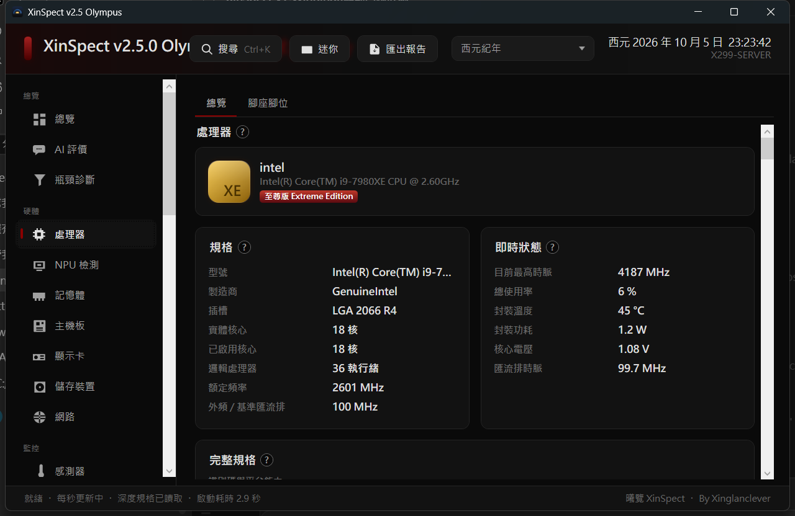
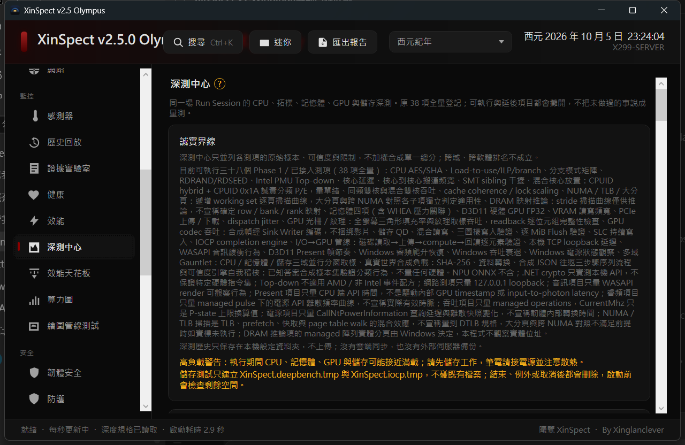
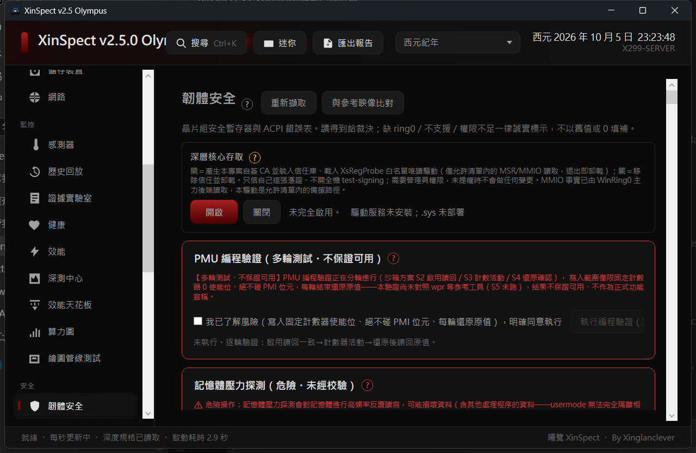
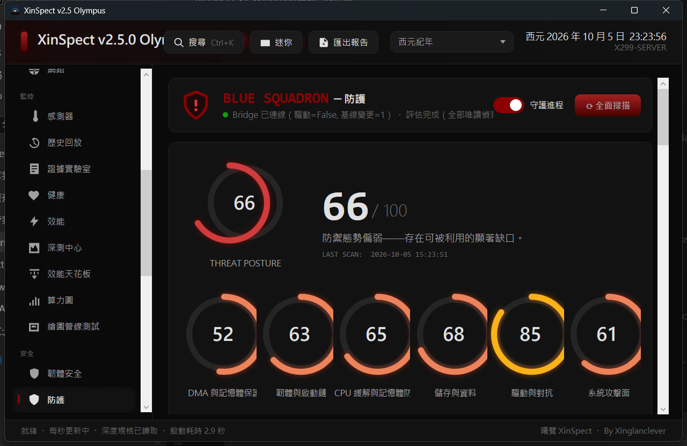

[繁體中文](README.md) · 简体中文 · [English](README.en.md)

[](https://xinspect.de5.net)

> 官方网站只呈现说明（产品总览、事实目录、版本沿革、下载），**不会扫描你的电脑**，也不需要安装。

# 曦览 XinSpect

**同一台机器，三份陈述并排：硬件说的、固件说的、操作系统说的。**

能读到的给数值与出处（哪个寄存器、哪个 WMI 类、哪个 API），读不到的给原因，互相矛盾的用红字具名列出双方——判断留给你。

*Altius, accuratius, stabilius—veracius.*


-512BD4)


> Stryker 82% 仅覆盖 `XinSpect.Decoders` 纯解码器类库，不代表整个 GUI、CLI 或内核访问层。


一款**免费开源、Windows x64** 的电脑工具箱：验机、监控、超频、固件安全稽核、深度量测与证据导出。

单一运行档、免安装。底层读取**默认只读**；进阶诊断与 CPU／DRAM 压力测试**默认关闭**；硬件写入另有第二级开关并需逐项确认。**不收集、不上传任何用户数据。**

> 它不替你下结论。市面上的工具多半给你一个分数或一句「体质良好」；曦览给的是三份原始陈述与它们的出处，矛盾的地方具名列出，判断留给人。

## 目录

- [这是什么](#这是什么)
- [画面](#画面)
- [主要功能](#主要功能)
- [三源对账与六态](#三源对账与六态)
- [下载](#下载)
- [快速开始](#快速开始)
- [xsc 终端机](#xsc-终端机)
- [安全边界与数据主权](#安全边界与数据主权)
- [可复算的事实表](#可复算的事实表)
- [诚实边界](#诚实边界)
- [从源码构建](#从源码构建)
- [文档导航](#文档导航)
- [授权](#授权)

## 这是什么

曦览的立场很简单：**一台电脑的每一性质，都应该分成三份陈述来看**——硬件自己说的（寄存器、SPD、SMART）、固件说的（SMBIOS、ACPI、SPI 防写状态）、操作系统说的（WMI、PnP、ETW）。三者一致时你得到一个可信的数字；三者不一致时，工具的工作是**把矛盾指出来**，而不是挑一个顺眼的盖掉。

- **适合**：想确认买到的内存是不是标示的颗粒与时序、想查固件防写与 Secure Boot 状态、想看传感器与功耗曲线、想跑有记录可回查的压力测试、想把一台机器的事实导出成证据。
- **不适合**：想要「跑分排名」、想要「一键超频到最高」、想要一句「这台值不值得买」。本工具不给采购建议，也不跨机型排名。

## 画面

| 处理器 | 深测中心 |
|---|---|
|  |  |
| 规格与即时状态并列，读值附出处 | 38 项可执行项全量登记，不做的项目也列出来 |

| 固件安全 | 防护 |
|---|---|
|  |  |
| 读到就给裁决，缺权限就诚实标示原因 | BlueSquadron 威胁态势与逐项评分 |

> 上列画面截取自 **v2.5.0**；v3.27 的页面数量、版式与信息密度均已变动，实际以程序为准。

## 主要功能

65 个可到达页面，依用途分六组：

| 分组 | 内容 |
|---|---|
| **验机与对账** | 总览、处理器（含脚座位脚图）、NPU 检测、内存（SPD 直读／SMBIOS-WMI／CPU-Z 三来源并列）、主板、显卡、存储设备（SMART／NVMe）、网络、传感器、硬件目录、事实地图 |
| **监控与量测** | 即时传感器、历史回放、传感器仪表板、帧时间（ETW）、DPC 延迟、网络速度、功耗（RAPL 能量计验证）、健康 |
| **效能与压力** | 效能天花板、算力图、绘图管线测试、GPU 渲染测试、深测中心（44 项 Run Session）、CPU／DRAM／GPU 压力测试、磁盘扫描、硬件测试（键盘／鼠标／屏幕）、瓶颈诊断 |
| **固件与安全** | 固件安全（芯片组安全寄存器、ACPI 错误表、SPI BIOS 防写）、驱动分析、系统分析、BlueSquadron 防护（威胁态势与扫描） |
| **系统工具** | 终端机（强控台）、DNS、Hosts、右键菜单、启动修复、启动项、垃圾清理、内存清理、休眠／显示链接／NVMe 电源、端口、蓝屏分析、系统迁移、超频（CPU／GPU）与风扇 |
| **证据与治理** | 证据实验室、合规报告、Merkle 证据、审计日志哈希链、企业离线基准、来源与授权页 |

另有 **AI 评价**（自备 API 密钥）与**内置浏览器**（只开 http／https，边界见下节）。

## 三源对账与六态

每一页的数据都标出**它从哪里来**。同一个字段有两条以上来源时，曦览会并列列出，不一致就用红字标示「硬件说 X／操作系统说 Y」。

读不到的时候，它不是填 0、也不是填一条看起来很正常的假值，而是给出**原因**：缺权限、硬件不支持、驱动未载入、固件未实现、超时、被安全设置挡下。这就是所谓的六态：**「读不到」与「值是零」在画面上必须长得不一样**，否则一份看起来完整的报告就是一份骗人的报告。

未提权不是坏掉——那些页面会整片显示「—」与原因，这正是六态降级设计存在的理由。

## 下载

| 文件 | 大小 | 说明 |
|---|---|---|
| [XinSpect.exe](https://github.com/Xinglanclever/XinSpect/releases/download/v3.27/XinSpect.exe) | 39,263,340 bytes | 主程序。蓝色中队守护进程已内置；「强控台」按钮桥接 xsc 终端机 |
| [XinSpectConsole.exe](https://github.com/Xinglanclever/XinSpect/releases/download/v3.27/XinSpectConsole.exe) | 101,273,958 bytes | 曦览终端机（CLI）。可独立运行，也被主程序强控台唤起；自带 .NET 10 运行时故体积较大 |
| [BlueSquadronBridge.exe](https://github.com/Xinglanclever/XinSpect/releases/download/v3.27/BlueSquadronBridge.exe) | 6,531,620 bytes | 独立守护进程。要脱离主程序单独跑防护时使用 |
| [XinSpect-full.exe](https://github.com/Xinglanclever/XinSpect/releases/download/v3.27/XinSpect-full.exe) | 212,029,587 bytes | 主程序・带环境版：.NET 10 Desktop Runtime 一并打包，免装运行时（功能与 XinSpect.exe 相同） |
| [XinSpectConsole-nort.exe](https://github.com/Xinglanclever/XinSpect/releases/download/v3.27/XinSpectConsole-nort.exe) | 67,341,273 bytes | 曦览终端机・Windows 11／Server 2025・不带环境：需已装 .NET 10 Desktop Runtime |
| [XinSpectConsole-legacy-nort.exe](https://github.com/Xinglanclever/XinSpect/releases/download/v3.27/XinSpectConsole-legacy-nort.exe) | 67,341,361 bytes | 曦览终端机・Windows 10／2016/2019/2022・不带环境：纯文本界面，需已装 .NET 10 Desktop Runtime |
| [XinSpectDeploy.exe](https://github.com/Xinglanclever/XinSpect/releases/download/v3.27/XinSpectDeploy.exe) | 29,696 bytes | 一键安装器。第一层选装什么：A 装主程序（GUI）、B 装曦览终端机；第二层 1/2/3 选下载来源（GitHub／Drive／加速节点） |
| [XsRegProbe.sys](https://github.com/Xinglanclever/XinSpect/releases/download/v3.27/XsRegProbe.sys) | 24,064 bytes | XsRegProbe 内核探测驱动（白名单只读 MSR／MMIO；内部检视不构成第三方认证）。未微软签名：主程序以提权会话安装到 `ProgramData\XinSpect\Driver\` 并建服务；手动加载需测试签名环境（testsigning） |
| [XinSpectConsole-legacy.exe](https://github.com/Xinglanclever/XinSpect/releases/download/v3.27/XinSpectConsole-legacy.exe) | 101,274,046 bytes | 曦览终端机（CLI）**纯文本兼容版**：给 Windows 10／Windows Server 2016、2019、2022 的传统主控台——无色彩、无框线定位，其余功能（facts／book／help）相同 |

> **上表的字节数为本版（v3.27）实际发布的文件大小**；请以 Release 页面列出的文件为准。逐资产 SHA-256 见 Release 页的 `SHA256SUMS.txt`（防传输损毁；能替换整个 Release 的攻击者防不了——不可否认性需签名，列排期）。

**需求**：Windows 10 1903 以上／Windows 11、x64。不带环境的版本需先安装 .NET 10 Desktop Runtime；`XinSpect-full.exe` 与 `XinSpectConsole.exe` 已自带运行时。

**安装器**（`XinSpectDeploy.exe`）第一层先选装什么：**A** 是主程序（全自动部署主程序＋守护进程；守护进程自 3.13 起默认不启用，要自己到安全页开）、**B** 是曦览终端机（单档下载一步到位）。下载完成后一律检查 PE 标头与大小门槛，抓到 HTML（分享页、限流页）会被挡下、删档并说出内容像什么。注意：走第三方加速节点的字节只能验 PE 标头，验不了发布者签名。

## 快速开始

1. **下载** `XinSpect.exe`（或运行 `XinSpectDeploy.exe` 一键安装）。想先看它会做什么，可开[官方网站](https://xinspect.de5.net)。
2. **直接运行**。默认以一般权限启动（asInvoker，最小特权）：验机、对账、导出报告都能用。
3. **要看完整功能**（传感器、MSR 直读、超频、固件安全深层项）时，才「以系统管理员身分运行」——不提权只是那些页面显示「—」与原因，不是坏掉。
4. 进阶诊断与压力测试在**安全页**才打得开；硬件写入是第二级开关，且每一次写入都要逐项确认。

卸载：主程序是单一运行档，删掉即可；若曾安装 XsRegProbe 服务，于安全页或 `xsc --repair-ring0` 清理。

## xsc 终端机

`XinSpectConsole.exe`（`xsc`）是同一个产品对终端与脚本的入口：**49 个指令**，与 GUI 共用同一套只读服务——不新增写入、不常驻、不联网。

```text
xsc                          # 进入 REPL（↑↓ 历史、Tab 补全、Ctrl+C 停）
xsc help                     # 指令总表
xsc facts                    # 采集全机事实
xsc page cpu                 # 单页事实
xsc domain storage           # 依事实域查询
xsc fact cpu.model           # 单一事实
xsc msr 0x19C                # 直读 MSR（需提权）
xsc pci scan                 # PCI 扫描
xsc health                   # 健康摘要
xsc compliance               # 合规证据导出
xsc merkle                   # Merkle 证据
xsc book                     # 离线百科（内嵌）
xsc --lang zh-TW             # 界面语言
```

- `xsc top` 是即时刷新视图，**Ctrl+C 停止**；管道模式下会拒绝启动，不让脚本挂死。
- `xsc --repair-ring0` 是**明示**的修复动作（删除死指针的 WinRing0 服务）——系统写入不藏在别的旗标底下；只读健检另有 `DiagnoseRing0Service`。
- `xsc --verify-audit [日志路径]` 逐笔重算审计日志的哈希链：退出码 0＝链完整、2＝链断或文件损毁、1＝致命。

## 安全边界与数据主权

- **默认只读**。底层读取（寄存器、SPD、SMART、ACPI）默认只读不写；进阶诊断与 CPU／DRAM 压力测试默认关闭；硬件写入需第二级开关＋逐项确认。
- **没有任何遥测**。不收集、不上传用户数据，没有账号、没有云端同步；所有即时数据只留在这台机器。
- **需要联网的功能全部逐项 opt-in**，共五条路径；其余一律本机完成。
- **API 密钥以 Windows DPAPI 加密后才写进 settings.json**，解不开就是「没有密钥＋原因」，设置页显示磁盘上实际的存放方式。
- **内置浏览器只开 http／https**：`file://`、`javascript:`、`data:`、`about:` 等一律挡下，左下角说明被挡的是什么。
- **浏览器下载落在 `%USERPROFILE%\XinSpect\Downloads`**，不落系统下载文件夹。
- **暂时性失败重试**（429／502／503／504／408，依端点的 `Retry-After`、有限次），且只在还没吐出任何字之前重试。
- **开发者工具默认关闭**，只在明确设置 `XINSPECT_BROWSER_DEVTOOLS=1` 后才开启。
- **提权是可选的**：主程序以最小特权启动，只有需要内核通路的页面才要求管理员。

## 可复算的事实表

下表每一个数字都能在干净 checkout 上当场数出来。**数法是内容的一部分**：换一种数法得到别的数字是正常的，但数法必须写出来。

| 项目 | 数量 | 数法（在仓库根运行） |
|---|---:|---|
| 事实键目录 | 1,178 键／157 个前缀 | `Services/FactKeyCatalog.cs` 的 `Keys` 成员数，取第一段前缀去重 |
| 动态键家族 | 69 个 | `Services/FactKeyDynamicCatalog.cs` 的 `Families` 成员数 |
| 可到达画面 | 65 | `Nav/PageRegistry.cs` 的 `Key =` 条目数 |
| 说明条目 | 288 | `Nav/HelpCatalog.cs` 的 `Entries` 成员数 |
| 服务文件 | 682 | `find Services -name '*.cs' \| wc -l` |
| 运行期测试案例 | 8,050（`Tests/TestSuiteBaseline.cs` 的 `ProjectTests`） | `dotnet test` 总数 |
| CLI 指令 | 49 | `grep -c 'case "' XinSpectCli/Program.cs` |
| 版本记录 | 132 | `Nav/ChangelogCatalog.cs` 的 `Entries` 成员数 |

**这张表不能证明什么。** 1,178 是硬件、操作系统、安全、诊断、来源与治理等项目的整体目录数，不是 1,178 项硬件读值。

## 诚实边界

1. **内核通路**：生产路径是第三方 **WinRing0** 与自研 **XsRegProbe**（白名单只读 MSR／MMIO）。**PawnIO 未接入**；**BlueSquadron** 的 C 内核驱动只在本机编译通过，未封装、未签名、未执行验证，**不列为生产内核路径**。
2. **没有微软签名**（EV 证书＋WHQL 是钱与流程）。因此「从 GitHub Release 直连下载」是使用者的必要纪律；`SHA256SUMS.txt` 只能防传输损毁。
3. **审查不是第三方认证**。v3.17 的 116 条与 v3.18 的 111 条是作者与 AI 代理辅助的内部检视，含审查者自己的误报；见 [docs/審查報告-v3.17.md](docs/審查報告-v3.17.md)。
4. **硬件长尾**：特殊芯片组、OEM 定制 BIOS、虚拟机与老平台会落回六态的「读不到＋原因」。
5. **判断留给人**：本工具不回答性能排名、推荐配置、购买建议，也不跨机型比大小。
6. **文档税**：代码、键目录、说明条目、百科、README 是五重表示；守门测试钉住一致性，而守门也会红灯失守。
7. **bus factor**：项目由单人＋AI 代理维护，质量依赖守门人本人。

## 从源码构建

需要 .NET 10 SDK（本项目以 `net10.0-windows` 编译，WPF＋WinForms 系统托盘），文档工具另需 Python 3。

```bash
git clone https://github.com/Xinglanclever/XinSpect.git
cd XinSpect

dotnet build XinSpect.csproj -c Release
dotnet build XinSpectCli/XinSpectCli.csproj -c Release
dotnet test Tests/XinSpect.Tests.csproj          # 8,050 项基线

python Tools/gen-docs-html.py                    # 生成 百科.html／手册.html
python Tools/gen-readme-domains.py --check       # 守门：README 逐域展开与键目录一致
```

送 PR 前请先读 [CONTRIBUTING.md](CONTRIBUTING.md)；安全问题请依 [SECURITY.md](SECURITY.md) 回报。

## 文档导航

| 文件 | 内容 |
|---|---|
| [官方网站](https://xinspect.de5.net) | 产品总览、事实目录、功能与数据源、版本沿革、下载（双语） |
| [百科.html](百科.html) · [手册.html](手冊.html) | 自足 HTML，含目录与锚点，离线可读（程序内「百科」即此档） |
| [docs/百科-v3.17.md](docs/百科-v3.17.md) | 百科叙述主体：逐页解剖、逐键出处、门槛速查 |
| [docs/FEATURE-REFERENCE.md](docs/FEATURE-REFERENCE.md) | 功能与数据源对照 |
| [WHITEPAPER.zh-CN.md](WHITEPAPER.zh-CN.md) | 设计白皮书（简体中文） |
| [THIRD-PARTY-NOTICES.md](THIRD-PARTY-NOTICES.md) | 第三方组件授权与来源 |

## 参与与回馈

- 送 PR／回报问题前先读 [CONTRIBUTING.md](CONTRIBUTING.md)；行为准则见 [CODE_OF_CONDUCT.md](CODE_OF_CONDUCT.md)。
- 安全问题请依 [SECURITY.md](SECURITY.md) 私下回报，不要在 issue 里贴未修补的细节。
- 使用问题与已知限制见 [SUPPORT.md](SUPPORT.md)。

## 授权

双授权，两条路二选一、功能相同：

- **AGPL-3.0-or-later**：免费、可商业使用，但散布修改版或以网络服务提供时须以相同授权开源。
- **商业授权**（见 [COMMERCIAL-LICENSE.md](COMMERCIAL-LICENSE.md)）：付费，供闭源整合、随机出货或组织政策禁用 copyleft 的情况，不触发源码公开义务。

第三方组件（Intel XTU SDK／LibreHardwareMonitor／TraceEvent／NAudio／WebView2 等）维持各自授权。

## 版本沿革

- **v3.27 内存 WMI 即时回退与 SPD 超时修正**（2026-11-12）：内存 WMI 即时回退与 SPD 超时修正。
- **v3.26 DIMM SPD 侦测与诊断修正**（2026-11-12）：iMC 改用 Windows PnP 定位；补上 DDR5 0x51–0x57 hub 侦测及三来源与耗时诊断。
- **v3.25 双级安全模式与平台靶向深测**（2026-11-11）：两级开关默认关闭；桌面与 CLI 共用安全设置及平台靶向 Deep Bench。
- **v3.24 监控效能修正**（2026-11-10）：降低即时监控开销与修正流量基准；SPD JEDEC 基准不再被当成目前运行时序。
- **v3.23 硬件判读修正**（2026-11-10）：硬件解码与证据准确度修正。
- **v3.22 企业离线基准**（2026-11-10）：企业离线基准与硬件来源契约。
- **v3.21 深审第二批修正版**（2026-11-09）：第三轮扫掠 15 补丁落地＋审计清单收口＋xsc 输入区单线。
- **v3.20 修复构建＋全库深审**（2026-11-08）：三处构建复通、CLI／桌面／服务层 30+ 修正。
- **v3.18 审计落实版**（2026-11-07）：116 条修正＋功耗诚实闸门＋按需提权。
- **v3.17 终端机定稿**（2026-11-05）：Claude Code 式界面、永不崩 REPL、百科嵌入。

完整 132 笔沿革见 [docs/百科-v3.17.md](docs/百科-v3.17.md) 第 11 部。

## 赞助

若你愿意支持个人维护，可请作者喝杯咖啡；每笔赞助请至少等值 **1.5 USD**。这只是自愿赞助渠道，不附带支持或回复承诺。请先核对币种与网络；链上转账通常无法撤回。

| 币种 | 网络 | 地址 |
|---|---|---|
| USDT | Tron (TRC20) | `TQPk1DfaHBCKNt8W5UUJDH3XkwAArmmNqH` |
| USDT | Solana | `34o5GGmamdV8k9vYYaaRABZpSNXpphbSXdhBsASN8XN4` |
| USDT | BNB Smart Chain (BEP20) | `0x8811d8EF822cC9cf546fe24C565b861291e1B704` |
| USDC | Ethereum (ERC20) | `0x8811d8EF822cC9cf546fe24C565b861291e1B704` |
| USDC | Solana | `34o5GGmamdV8k9vYYaaRABZpSNXpphbSXdhBsASN8XN4` |
| ETH | Ethereum | `0x8811d8EF822cC9cf546fe24C565b861291e1B704` |
| BTC | Bitcoin | `1PsY7aUbmHEVdM4g5EVQLncMFDEFnak3qF` |

---

**本文档对应 XinSpect v3.27（2026-11-12）**，与 [docs/百科-v3.17.md](docs/百科-v3.17.md) 的叙述主体同步；三份 README 的差异只在语言，数字与安全边界由守门测试钉成同一组。
